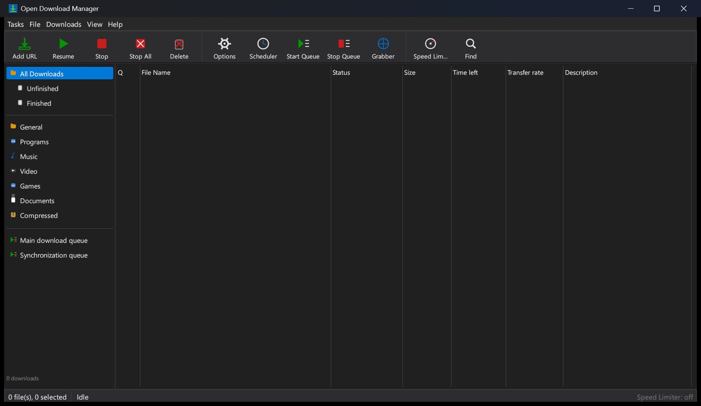
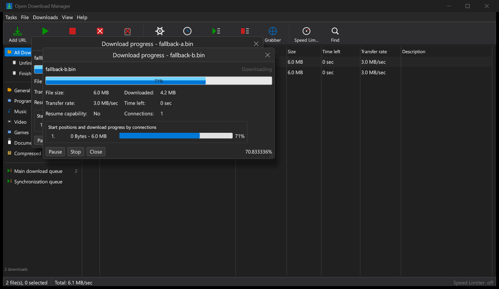

# Open Download Manager

[](https://github.com/imacncheese/open-download-manager/actions/workflows/ci.yml)

A free, open Rust download manager with the familiar layout and workflow of
classic Internet Download Manager 6.43 — **no registration, account, serial,
activation or trial timer**.



Live progress windows open automatically for every started download (including
multiple simultaneous downloads):



## What it does

| Area | Status |
|---|---|
| Segmented HTTP/HTTPS downloads (1–32 connections, default 8) | ✅ |
| Dedicated live progress window per active download (per-connection bars) | ✅ |
| Resume after stop/crash (per-connection part files) | ✅ tested |
| Byte-exact assembly + `Last-Modified` preservation | ✅ tested |
| Categories, per-category folders/file masks/sites | ✅ |
| Queues, max concurrent downloads, queue start/stop | ✅ |
| Scheduler (time/day window, limits, shutdown/sleep/hibernate/exit) | ✅ |
| Speed Limiter (global + per-download, KB/s) | ✅ |
| Proxy (system/manual/socks), auth, cookies, referer, User-Agent | ✅ |
| Per-server connection exceptions | ✅ |
| Browser takeover via native messaging (Chrome/Edge/Firefox) | ✅ |
| In-page media download panel | ✅ |
| Clipboard monitoring + prompt | ✅ |
| Batch download with `*` ranges | ✅ |
| Site Grabber (BFS crawler, filters, download checked) | ✅ basic |
| Import/export link lists, search/find, sortable columns | ✅ |
| Tray icon, minimize/close to tray, single instance | ✅ |
| Dark mode, large/small/classic toolbar | ✅ |
| FTP, video/audio muxing, VPN/dial-up, virus scanning | ⚠️ config only / not implemented |

See [docs/FEATURE_MATRIX.md](docs/FEATURE_MATRIX.md) for the full comparison and
[docs/REVERSE_ENGINEERING.md](docs/REVERSE_ENGINEERING.md) for the
reverse-engineering evidence behind the behaviour.

## Quick start

Requirements: Windows 10/11, Rust 1.85+ with the MSVC toolchain
(`winget install Rustlang.Rustup Microsoft.VisualStudio.2022.BuildTools`).

```powershell
git clone https://github.com/imacncheese/open-download-manager.git
cd open-download-manager
.\build.ps1              # cargo build --release + stage the extension
.\target\release\OpenDownloadManager.exe
```

### MSI installer (no admin required)

Download the latest `OpenDownloadManager-1.0.7.msi` from
[Releases](https://github.com/imacncheese/open-download-manager/releases/latest),
or build it locally:

```powershell
.\installer\build-msi.ps1 -Version 1.0.7
.\dist\OpenDownloadManager-1.0.7.msi
```

The MSI installs the app, Start-menu shortcut, browser integration and a clean
per-user Add/Remove Programs entry; uninstall removes all of them. See
[docs/INSTALLER.md](docs/INSTALLER.md) for contents, silent-install switches and
how to rebuild the package.

Install for the current user without the MSI:

```powershell
.\install.ps1
```

### Browser integration

1. Run `odm-native-host.exe --install` (also available in Options → Browser).
2. Open `chrome://extensions` (or `edge://extensions`), enable Developer mode,
   **Load unpacked**, and select the `extension` folder next to
   `OpenDownloadManager.exe`.
3. Downloads are cancelled in the browser and handed to Open Download Manager;
   the “Download with ODM” context-menu items and the media panel are added.

Firefox uses the same host manifest (`com.opendm.host`), installed under
`HKCU\Software\Mozilla\NativeMessagingHosts`.

## Using it

* **Add URL** (`Ctrl+N`) → the download starts with up to
  `Options → Connection → Max. connections` connections.
* The main list mirrors the classic layout: `Q`, File Name, Status, Size,
  Time left, Transfer rate, Description (more columns in View → Columns).
* Double-click a row for the **Download progress** dialog with per-connection
  bars; right-click for resume/stop/remove/properties/open folder.
* **Downloads → Scheduler and queues** configures start/stop windows and
  download limits; **Start Queue / Stop Queue** drive queue processing.
* **Tasks → Run site grabber** explores a site and adds the checked files.
* State lives in `%APPDATA%\OpenDownloadManager` (config.json, downloads.json,
  temp\). `ODM_HOME` overrides the location; a writable fallback is used when
  the profile is locked down.

## Architecture

```
crates/odm-core     engine, model, persistence, HTTP probe, scheduler, grabber
crates/odm-app      egui GUI (main window, dialogs, tray)
crates/odm-host     native messaging host (odm-native-host)
extension/          Manifest V3 integration module
```

* **Engine** — Tokio runtime, one supervisor task per download, one task per
  connection. Each connection writes its own part file at absolute offsets;
  progress is persisted every 3 s so a crashed transfer resumes. Completion
  assembles parts into the target folder and preserves the server timestamp.
* **UI** — `eframe`/`egui` with Segoe UI and a custom-drawn toolbar.
* **Integration** — loopback TCP IPC (`ipc.json`, token-authenticated) shared by
  the native host, secondary app instances and tests.

## Tests

```powershell
cargo test -p odm-core --tests
```

* `engine_test` — 1 MiB+ file over a Range server, 4 connections, byte-exact
  output.
* `resume_test` — stop mid-transfer, verify partial data, resume, byte-exact
  output.

A live end-to-end run through the app's IPC downloaded 8,389,385 bytes with
SHA-256 `f572a84b…dc7f0`, matching the server payload exactly.

## Attribution and license

The UI catalogue and defaults were reconstructed from the installed IDM 6.43
copy for interoperability; “Internet Download Manager” and “IDM” are trademarks
of Tonec Inc. This project contains no Tonec binaries or assets, and no
registration or activation checks are present or bypassed. The Rust code is MIT
licensed. Use only with content you are allowed to download.
